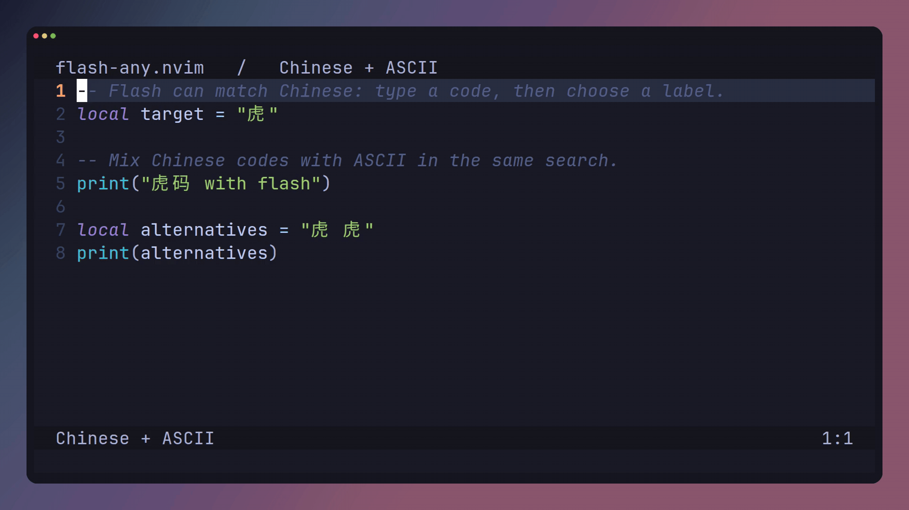

# Tiger codes for flash-any.nvim

[简体中文](README.zh-CN.md)

Single-grapheme encodings for search and jump in Neovim with
[flash-any.nvim](https://github.com/dirichy/flash-any.nvim).

## Install

Requires Neovim 0.11+, plus make and a C toolchain for the initial native build.

```lua
{
  "dirichy/flash-any.nvim",
  branch = "main",
  version = false,
  dependencies = { "folke/flash.nvim", "dirichy/flash-any-tiger.nvim" },
  build = "make",
  opts = function()
    local tsv = assert(vim.api.nvim_get_runtime_file("lua/flash-any/tables/tiger.tsv", false)[1])
    return {
      sources = {
        {
          file = tsv,
          format = "tsv",
          columns = { "text", "code", "weight", "order" },
          selection = { keys = { " ", ";" } },
        },
      },
    }
  end,
  keys = {
    { "s", mode = { "n", "x", "o" }, function() require("flash-any").jump() end },
  },
}
```

Press `s`, type the code, then select a label. ASCII literal matching is automatic.
If using a converter, disable selection first. Conversion runs only while compiling.

## Format

UTF-8 TSV: grapheme, Tab, then one code. Repeat rows for multiple codes.
Commas in codes are literal; sorting is unnecessary. Rime/CSV/Fcitx/IBus are also supported.
Each key must be one complete grapheme. Converted codes must be nonempty ASCII.

```text
虎<TAB>zhh<TAB>38896<TAB>1119
虎<TAB>zh<TAB>256<TAB>14838
羔<TAB>gch<TAB>1420<TAB>3819
```

## Demo



Record against the unchanged project using flash-any's recording tools:

```sh
# Run in the flash-any.nvim checkout; see its demos/README.md for recording tools.
TABLE_FILE=/path/to/this-project/lua/flash-any/tables/tiger.tsv sh demos/record.sh table
```

Alternatively copy flash-any's `demos/templates/table-demo.yml` to
`.github/workflows/demo.yml`, adjust the TSV path / matcher and run it manually.
The workflow uploads GIF, MP4, cover and live playback reports as an artifact.
It does not publish a release.

## License


## Tiger selection keys

`opts = { sources = { "tiger" } }` uses this package’s source factory with the same defaults.
Space and semicolon are optional first/second candidate keys. Bare codes remain valid
for every candidate: gch; selects 羔, while gch still accepts all candidates.
Punctuation is included in the same TSV and receives no selector. Only codes containing
ASCII letters participate in ranking. Columns are text/code/weight/original order.

## Maintenance

```sh
python scripts/build.py tiger.dict.yaml lua/flash-any/tables/tiger.tsv
```

The generator writes only the complete TSV; no common Lua cache or runtime punctuation
module is needed. Python is a maintainer dependency only. This repository and its demo
artifacts are private; installing it requires GitHub authentication.
Original code uses [MIT](LICENSE). Upstream data and weight notices are in
[THIRD_PARTY.md](THIRD_PARTY.md).
