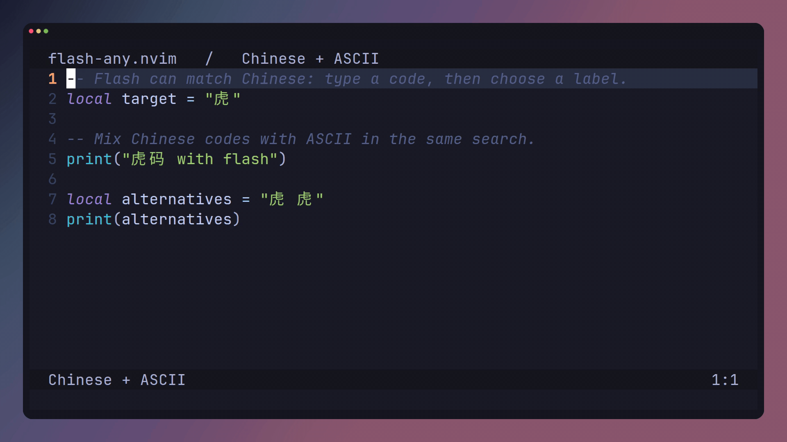

# flash-any.nvim 虎码

[English](README.md)

为 [flash-any.nvim](https://github.com/dirichy/flash-any.nvim) 提供单字素编码，
使用本码表在 Neovim 中搜索跳转。

## 安装

需要 Neovim 0.11+，首次构建需要 make 和 C 工具链。

```lua
{
  "dirichy/flash-any.nvim",
  branch = "main",
  version = false,
  dependencies = { "folke/flash.nvim", "dirichy/flash-any-tiger.nvim" },
  build = "make",
  opts = function()
    local tsv = assert(vim.api.nvim_get_runtime_file("lua/flash-any/tables/tiger.tsv", false)[1])
    return {
      sources = {
        {
          file = tsv,
          format = "tsv",
          columns = { "text", "code", "weight", "order" },
          selection = { keys = { " ", ";" } },
        },
      },
    }
  end,
  keys = {
    { "s", mode = { "n", "x", "o" }, function() require("flash-any").jump() end },
  },
}
```

按 `s`，输入编码，再按标签跳转。ASCII 字面匹配自动启用。
若需要编码转换，可在 source 中添加 `converter = "/path/converter.lua"`；
转换器只在构建时运行，返回编码数组，不参与运行时匹配。

## 码表格式

TSV 每行一个字素、Tab、编码，多编码重复写行；逗号原样保留，无需排序。
也可直接提供 Rime、CSV、Fcitx 或 IBus 文件。
每个键须恰好一个完整字素，编码在转换后须为非空 ASCII。

```text
虎<TAB>zhh<TAB>38896<TAB>1119
虎<TAB>zh<TAB>256<TAB>14838
羔<TAB>gch<TAB>1420<TAB>3819
```

## 演示



无需改码表项目即可用 flash-any 的录制工具：

```sh
# 在 flash-any.nvim 仓库中执行；录制依赖见其 demos/README.md。
TABLE_FILE=/path/to/this-project/lua/flash-any/tables/tiger.tsv sh demos/record.sh table
```

也可复制 flash-any 的 `demos/templates/table-demo.yml` 到
`.github/workflows/demo.yml`，修改 TSV 路径和 matcher 后手动运行。
工作流上传 GIF、MP4、封面及回放验证报告，不自动发布 Release。

## 许可


## 虎码选键

也可用 `opts = { sources = { "tiger" } }` 加载本包工厂，等同于上面的文件配置。
默认首选空格、次选分号，均可省略；未分配选键的候选仍支持裸码。
例如 `gch;` 可以匹配二选“羔”；`gch` 仍支持所有候选。
标点已在同一份 TSV 中，不会获得选键。纯标点编码不参与候选排名。

## 维护

```sh
python scripts/build.py tiger.dict.yaml lua/flash-any/tables/tiger.tsv
```

只生成完整 TSV，没有常用字 Lua 缓存或运行时标点模块。Python 仅为维护者依赖。
本仓库为 private，安装需要 GitHub 认证；demo artifact 同样只对有权限的用户开放。
项目代码采用 [MIT](LICENSE)，码表来源和权重信息见 [THIRD_PARTY.md](THIRD_PARTY.md)。
